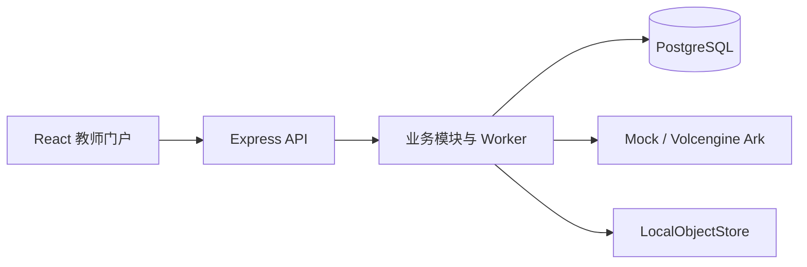

# 系统架构

Edu-Agent 采用 TypeScript 模块化单体：React 教师门户调用 Express API，七个服务端模块在同一部署单元中协作，使用 PostgreSQL 存储任务、教学内容、文件索引和教师偏好。

## 模块

| 模块 | Schema | 职责 |
| --- | --- | --- |
| `identity-governance-audit` | `governance` | 身份、学校、成员、会话、权限与操作记录 |
| `work-assistant-durable-execution` | `work` | 任务、会话、Todo、Calendar、工作投影与 Outbox |
| `agent-runtime-context` | `runtime` | Agent 运行、上下文与短期工作记忆 |
| `capability-integration` | `capability` | 模型执行、预算、Provider 与文件存储接口 |
| `artifact-collaboration` | `artifact` | 教案、建议、反思、文件和版本 |
| `education-domain` | `education` | 课程、课时、作业、批改、学习证据与课堂观察 |
| `personalization-memory-analytics` | `personalization` | 教师偏好及应用记录 |

模块拥有各自的状态，通过 Application Service、Port、Composition Service 和 Outbox 协作。前后端协议集中在 [packages/contracts](../../packages/contracts/)。

## 一次备课请求

1. 教师选择课时、资料与要求，创建或继续备课任务。
2. 服务端解析当前身份与可访问资源，组织任务上下文、会话记忆和已确认偏好。
3. Worker 调用模型，校验结构化输出，并保存 Proposal。
4. 教师审阅与批准教案版本，再生成和下载教学材料。
5. 课堂观察、作业反馈与反思进入下一次备课。

同一任务的 Conversation 保存在 Work 模块，派生的 WorkingMemory 保存在 Runtime；长期偏好由 Personalization 管理。运行记录保存上下文引用与版本，便于恢复和查看生成依据。

## 代码入口

- [Product Container](../../apps/api/src/composition/product-container.ts)：服务与 Adapter 装配。
- [业务模块](../../apps/api/src/modules/)：领域对象、Application Service 与 Repository。
- [HTTP API](../../apps/api/src/app.ts)：路由和中间件。
- [Migration registry](../../apps/api/src/database/migrations.ts)：数据库迁移。
- [Web API client](../../apps/web/src/api.ts)：教师门户的数据访问。

## 深入阅读

- [详细设计](system-design.md)：请求路径、教学与作业数据流、记忆、材料、Worker 和恢复。
- [模块边界](module-boundary-rules.md) · [架构决策](decisions/README.md)
- [开发指南](../engineering/README.md) · [部署准备](../operations/deployment-readiness-gaps.md)
